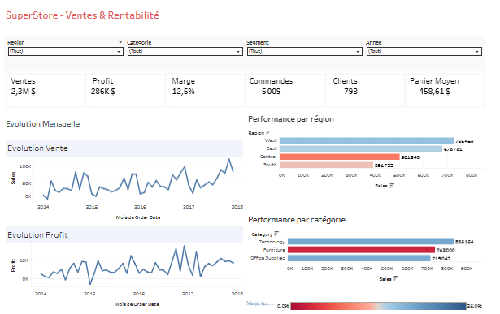
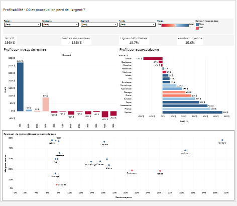

# Retail Sales & Profitability Analytics


Projet Data Analyst de bout en bout : des données brutes d'un distributeur jusqu'à des dashboards Tableau, en passant par un pipeline Python / SQL reproductible et validé automatiquement à chaque push.

## Question business

> **Comment l'analyse des données peut-elle aider une entreprise à comprendre sa performance commerciale et sa rentabilité, et à identifier des opportunités d'amélioration ?**

Le jeu de données [Sample Superstore](https://www.kaggle.com/datasets/vivek468/superstore-dataset-final) contient 9 994 lignes de commande d'un distributeur américain (mobilier, fournitures de bureau, technologie) sur la période 2014 – 2017.

## Résultats clés

**L'entreprise est rentable (12,5 % de marge) et en croissance, mais une partie importante de son profit est perdue à cause de remises plus élevées que ce que certains produits peuvent absorber.**

- **Les remises de 30 % ou plus sont toutes déficitaires.** Elles concernent 14 % des lignes et représentent une perte cumulée de **135 k$**, soit l'équivalent de 47 % du profit total.
- **Furniture génère 32 % des ventes mais seulement 6 % du profit.** Les pertes sont concentrées sur deux sous-catégories : **Tables** (−17,7 k$) et **Bookcases** (−3,5 k$).
- **Tables et Bookcases sont rentables sans remise** (environ 19 % de marge), mais leurs remises moyennes (21 à 26 %) dépassent cette marge et les font basculer en perte.
- **Central est la région la moins rentable** (7,9 % de marge) alors qu'elle a la meilleure marge sans remise des quatre régions : c'est aussi celle qui accorde les remises les plus fortes (24 % en moyenne).

**Recommandations :** plafonner les remises à 20 %, encadrer les remises sur Tables et Bookcases, revoir la politique commerciale de la région Central.

➡️ Analyse complète, chiffres, recommandations et limites : [`docs/insights.md`](docs/insights.md)

### Dashboards

📊 **[Voir le dashboard Executive Overview sur Tableau Public](https://public.tableau.com/views/SuperStore-VentesRentabilit/Tableaudebord1)**

KPIs globaux, évolution mensuelle des ventes et du profit, performance par région et par catégorie (couleur = marge par rapport à la moyenne de 12,5 %).



📊 **[Voir le dashboard Profitability sur Tableau Public](https://public.tableau.com/views/SuperStore-VentesRentabilit/Profitability)**

Où et pourquoi l'entreprise perd de l'argent : profit par niveau de remise, profit par sous-catégorie, et comparaison entre la remise moyenne et la marge sans remise de chaque sous-catégorie.



Les deux dashboards sont filtrables par année, région, catégorie et segment.

## Architecture du pipeline

```text
data/raw/superstore.csv          (données brutes, jamais modifiées)
        │
        ▼
1. INGESTION        src/ingestion/load_data.py           chargement (encodage cp1252) + diagnostic
        │
        ▼
2. VALIDATION       src/validation/validate_data.py      8 contrôles qualité (erreurs bloquantes / avertissements)
        │
        ▼
3. TRANSFORMATION   src/transformation/transform_data.py noms en snake_case, typage, colonnes dérivées
        │
        ▼
data/processed/superstore_clean.parquet
        │
        ▼
4. ANALYSE SQL      sql/analytics/*.sql (DuckDB)         KPIs, évolution, régions, catégories, remises
        │
        ▼
5. EXPORT           src/analytics/export_data.py         CSV pour Tableau
        │
        ▼
data/exports/*.csv  ──►  Tableau Public
```

Chaque étape est automatisée dans **GitHub Actions** : à chaque push, la CI installe l'environnement, valide les données, les transforme et exécute toutes les requêtes SQL. Si un contrôle qualité bloquant échoue, le pipeline s'arrête.

### Choix techniques

- **Validation avec deux niveaux de gravité** : les problèmes critiques (valeurs manquantes, remise hors bornes, expédition avant commande…) bloquent le pipeline ; les anomalies connues et documentées (un doublon potentiel, des `Product ID` ambigus) sont signalées en avertissement.
- **Parquet** pour les données transformées : il conserve les types (dates, codes postaux avec leurs zéros initiaux) et DuckDB le lit directement.
- **DuckDB** pour le SQL : un moteur analytique local, sans serveur à installer.
- **Données brutes jamais modifiées** : toutes les corrections sont faites dans l'étape de transformation et documentées.

## Qualité des données

Le diagnostic complet est dans [`docs/data_quality.md`](docs/data_quality.md). Points principaux :

- aucune valeur manquante ;
- fichier encodé en `cp1252` (et non UTF-8) ;
- **une ligne = un produit dans une commande** : le nombre de commandes se calcule avec `COUNT(DISTINCT order_id)` (5 009 commandes pour 9 994 lignes) ;
- dates stockées en texte et codes postaux stockés en nombres (zéros initiaux perdus), corrigés à la transformation ;
- un doublon potentiel conservé (aucune preuve d'erreur), suivi en avertissement par la validation.

## Technologies

| Domaine | Outils |
|---------|--------|
| Données | Python, Pandas, PyArrow (Parquet) |
| SQL | DuckDB |
| BI | Tableau Public |
| Environnement | uv |
| CI | GitHub Actions |

## Structure du repository

```text
Retail-sales-analytics/
├── .github/workflows/ci.yml     # pipeline CI
├── data/
│   ├── raw/                     # données brutes (versionnées)
│   ├── processed/               # Parquet nettoyé (généré)
│   └── exports/                 # CSV pour Tableau (générés)
├── docs/
│   ├── data_quality.md          # diagnostic qualité des données
│   └── insights.md              # analyse, recommandations, limites
├── sql/analytics/               # requêtes d'analyse DuckDB
├── src/
│   ├── ingestion/load_data.py
│   ├── validation/validate_data.py
│   ├── transformation/transform_data.py
│   └── analytics/export_data.py
├── pyproject.toml
└── uv.lock
```

## Lancer le projet

Prérequis : [uv](https://docs.astral.sh/uv/) (il installe la bonne version de Python automatiquement).

```bash
# 1. Installer l'environnement
uv sync

# 2. Diagnostic des données brutes
uv run python -m src.ingestion.load_data

# 3. Validation de la qualité des données
uv run python -m src.validation.validate_data

# 4. Transformation → data/processed/superstore_clean.parquet
uv run python -m src.transformation.transform_data

# 5. Exécution des requêtes SQL et export → data/exports/
uv run python -m src.analytics.export_data
```

Les commandes se lancent depuis la racine du projet.
